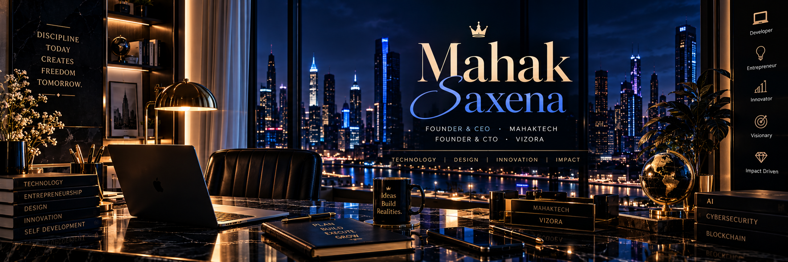

  

    

  
  &nbsp;
  

    

  

    

  
  

 

  
  
  
  

---

  <h2>01 &nbsp; / &nbsp; THE PERSON BEHIND THE VISION</h2>
  
<i>Ambition with intention. Progress with purpose.</i>

  
  

I'm **Mahak Saxena** — a computer science student, developer, and entrepreneur passionate about technology, innovation, and building meaningful things.

I enjoy understanding how technology works, exploring new possibilities, and turning ideas into practical digital experiences.

My journey brings together software engineering, entrepreneurship, creativity, and continuous learning.

- Building **MahakTech**, my technology venture.
- Developing **Vizora**, my vision for premium digital experiences.
- Exploring AI, cybersecurity, blockchain, and data privacy.
- Learning through hands-on development and experimentation.

I believe in traditional values, modern thinking, discipline, integrity, and the patience required to build something worthwhile.

One of my greatest motivations is to keep growing, create meaningful work, and make my parents proud.

  

> *Think traditionally. Create futuristically.*

---

  <h2>02 &nbsp; / &nbsp; THE VENTURES</h2>
  
<i>Two distinct identities. One long-term ambition.</i>

  
  

<table>
  <tr>
    <td width="50%" valign="top">
      

         
        
        <h2>MahakTech</h2>
        
<strong>FOUNDER &amp; CEO</strong>

        
<em>Technology with purpose.</em>

      

      

      
My technology venture focused on digital solutions and helping businesses build a stronger online presence.

      
<strong>AREAS OF FOCUS</strong>

      <ul>
        <li>Website development and redesigns</li>
        <li>Modern web applications</li>
        <li>Business-focused digital solutions</li>
        <li>Technology and innovation</li>
      </ul>
      

        
        
        
          
      

    </td>
    <td width="50%" valign="top">
      

         
        
        <h2>Vizora</h2>
        
<strong>FOUNDER &amp; CTO</strong>

        
<em>Where design meets technology.</em>

      

      

      
My vision for premium digital experiences combining elegant design, thoughtful engineering, and distinctive online identities.

      
<strong>AREAS OF FOCUS</strong>

      <ul>
        <li>Premium portfolio websites</li>
        <li>Websites for creative professionals</li>
        <li>Design-led web development</li>
        <li>Distinctive digital experiences</li>
      </ul>
      

        
        
        
          
      

    </td>
  </tr>
</table>

  

---

  <h2>03 &nbsp; / &nbsp; TECHNOLOGY &amp; ENGINEERING</h2>
  
<i>Learning the fundamentals. Exploring what's next.</i>

  
  
  
    
  
    
  

<table>
  <tr>
    <td width="32%"><strong>01 / FRONTEND</strong></td>
    <td>HTML, CSS, JavaScript, TypeScript, React, Next.js</td>
  </tr>
  <tr>
    <td><strong>02 / BACKEND</strong></td>
    <td>Node.js, Express.js, REST APIs</td>
  </tr>
  <tr>
    <td><strong>03 / DATABASES</strong></td>
    <td>MongoDB, MySQL, MariaDB</td>
  </tr>
  <tr>
    <td><strong>04 / EMERGING TECH</strong></td>
    <td>AI applications, cybersecurity, blockchain, data privacy</td>
  </tr>
  <tr>
    <td><strong>05 / WORKBENCH</strong></td>
    <td>Git, GitHub, Linux, Ubuntu, VS Code, Figma</td>
  </tr>
</table>

  

My toolkit evolves as I build, experiment, and deepen my understanding of software engineering.

---

  <h2>04 &nbsp; / &nbsp; THE MINDSET</h2>
  
<i>Quiet discipline. Bold ambitions.</i>

<table>
  <tr>
    <td width="50%" valign="top">
      

        
        
<strong>Build for lasting value.</strong>

      

      Look beyond temporary attention and focus on meaningful results.
    </td>
    <td width="50%" valign="top">
      

        
        
<strong>Never stop learning.</strong>

      

      Explore new ideas, ask better questions, and keep improving.
    </td>
  </tr>
  <tr>
    <td width="50%" valign="top">
      

        
        
<strong>Turn ideas into action.</strong>

      

      Make progress through consistent effort and practical work.
    </td>
    <td width="50%" valign="top">
      

        
        
<strong>Grow without losing your values.</strong>

      

      Let ambition strengthen your character, integrity, and responsibility.
    </td>
  </tr>
</table>

---

  <h2>05 &nbsp; / &nbsp; THE LONG-TERM VISION</h2>
  
  
  <h2>Building something worth remembering.</h2>

My goal is to become a stronger engineer, a thoughtful entrepreneur, and a leader who creates value through technology.

I want to grow MahakTech into a trusted technology brand and develop Vizora into a distinctive name in premium digital experiences.

I also want to deepen my understanding of AI, cybersecurity, and blockchain, discovering how emerging technologies can solve meaningful problems.

For me, success is not just about titles or recognition. It is about building useful products, taking responsibility, creating opportunities, and remaining grounded throughout the journey.

  

> *The goal isn't to look successful. It's to build something worth being proud of.*

---

  <h2>06 &nbsp; / &nbsp; THE BUILD LOG</h2>
  
<i>Progress over perfection.</i>

  
  
    
  
  
    
  

---

  <h2>07 &nbsp; / &nbsp; LET'S CONNECT</h2>
  
<i>Meaningful work begins with meaningful connections.</i>

  
  
    
  
  
    
  <a href="https://linkedin.com/in/mahak-saxena-658556385">LinkedIn</a>
  &nbsp; · &nbsp;
  <a href="https://mahak-0101.github.io/my-portfolio/">Portfolio</a>
    
  
  
    
  <h3><i>The world remembers those who build.</i></h3>
  MAHAK SAXENA · TECHNOLOGY · DESIGN · INNOVATION

